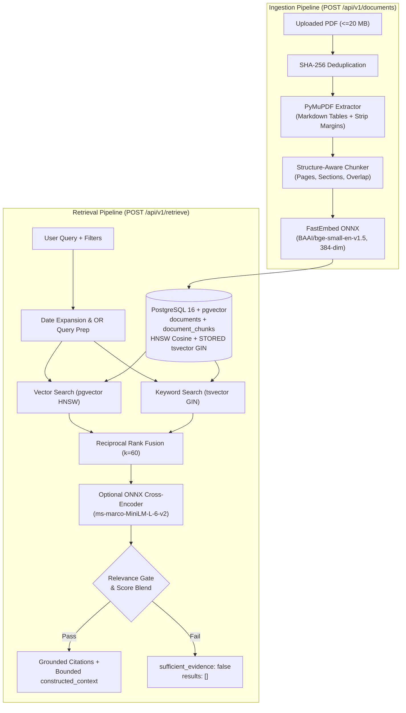

# Enterprise Ingestion & Retrieval Engine (Project 1)

A production-oriented, **$0-cost**, CPU-friendly document ingestion and hybrid retrieval microservice built for messy enterprise PDFs (government regulations, insurance policies, financial statements, legal contracts, and technical manuals).

Every retrieved passage carries **non-fabricable page-level citations**, and queries lacking sufficient evidence return an explicit refusal rather than low-confidence noise.

---

## Table of Contents

1. [Capabilities](#capabilities)
2. [Architecture](#architecture)
3. [Technology Choices & Trade-Offs](#technology-choices--trade-offs)
4. [Repository Structure](#repository-structure)
5. [Quick Start (Local Development)](#quick-start-local-development)
6. [Full Containerized Deployment (Docker Compose)](#full-containerized-deployment-docker-compose)
7. [Configuration Reference](#configuration-reference)
8. [Dry-Run PDF Inspection CLI](#dry-run-pdf-inspection-cli)
9. [API Reference & Examples](#api-reference--examples)
10. [How Hybrid Scoring & Citations Work](#how-hybrid-scoring--citations-work)
11. [Testing & Linting](#testing--linting)
12. [Known Limitations, Failure Modes & Scaling Path](#known-limitations-failure-modes--scaling-path)

---

## Capabilities

- **Messy PDF Parsing:** Uses PyMuPDF to strip repeating headers, footers, and page numbers across multi-page PDFs, repair hyphenated line wraps, and extract gridded tables into structured Markdown while excluding overlapping raw text to prevent duplication.
- **Explicit Failure Handling:** Rejects corrupted PDFs (`422 CORRUPTED_PDF`) and zero-text/scanned PDFs (`422 EMPTY_PDF_TEXT`) instead of silently indexing empty documents.
- **Structure-Aware Chunking:** Tracks `page_number`, `page_end`, `section_title`, and `chunk_type` (`text` | `table`), and repeats Markdown table headers when large tables span multiple chunks.
- **Idempotent Ingestion:** Computes SHA-256 `file_hash` on upload to prevent duplicate indexing and wasted compute.
- **Hybrid Search + RRF:** Combines `pgvector` HNSW cosine similarity and PostgreSQL `tsvector` GIN full-text search via Reciprocal Rank Fusion (`RRF`), with metadata filtering (`doc_type`, `source`, `document_ids`, `metadata_json`).
- **Date-Format Query Expansion:** Automatically expands natural-language dates (e.g., `"1st August 2023"`) into standard enterprise formats (`01-08-23`, `01/08/2023`, `2023-08-01`) with `OR`-based keyword matching.
- **Optional Local Cross-Encoder Reranking:** Supports ONNX cross-encoder reranking (`use_reranker: true/false`) with blended RRF + sigmoid scoring and table-protection rules.
- **Strict Citations & Refusal:** Every result includes `document_name`, `page_number`, `section_title`, `chunk_id`, and a full score breakdown (`vector_score`, `keyword_score`, `rrf_score`, `rerank_score`). Weak matches return `sufficient_evidence: false`.
- **Observability Ready:** Single-line structured JSON logs with `X-Request-ID` correlation across requests, plus `/health/live` and `/health/ready` probes.

---

## Architecture



---

## Technology Choices & Trade-Offs

| Component                 | Selected Stack               | Why Chosen (Trade-Offs)                                                                                                                                                                                                                                                                                           |
| :------------------------ | :--------------------------- | :---------------------------------------------------------------------------------------------------------------------------------------------------------------------------------------------------------------------------------------------------------------------------------------------------------------- |
| **API Framework**         | FastAPI + Pydantic v2        | Strong request/response validation, automatic OpenAPI docs (`/docs`), clean dependency injection for testing.                                                                                                                                                                                                     |
| **Database & Vectors**    | PostgreSQL 16 + `pgvector`   | Stores relational metadata, `JSONB` filters, `GENERATED ALWAYS ... STORED` `tsvector` full-text indexes (`GIN`), and `384`-dim vectors (`HNSW`) in **one** `384 MB`-capped container. Avoids split-brain sync bugs from running a separate vector DB (Pinecone) or non-transactional in-memory libraries (FAISS). |
| **Vector Index**          | `HNSW` (`vector_cosine_ops`) | Unlike `IVFFlat`, `HNSW` does not require pre-existing training data on migration and maintains high recall as documents are added incrementally.                                                                                                                                                                 |
| **Embeddings & Reranker** | `fastembed` (ONNX Runtime)   | Runs 100% locally at **$0 cost** with **no PyTorch installation** (~2 GB+ disk/RAM saved). Sized for CPU-only, low-RAM hosts (~6 GB usable RAM).                                                                                                                                                                  |
| **PDF Parsing**           | PyMuPDF (`fitz`)             | Fast C-backed extraction with bounding-box coordinates and built-in `find_tables()`, without heavyweight OCR dependencies.                                                                                                                                                                                        |
| **Migrations**            | Alembic                      | Versioned, reversible SQL schema migrations reading `DATABASE_URL` directly from application settings.                                                                                                                                                                                                            |

---

## Repository Structure

```text
enterprise-rag-engine/
├── .env.example                 # Template environment configuration
├── .dockerignore
├── .gitignore
├── Dockerfile                   # Non-root Python 3.11-slim container build
├── docker-compose.yml           # Memory-capped Postgres+pgvector & API service
├── pyproject.toml               # Dependencies, pytest, and ruff configuration
├── alembic.ini
├── alembic/
│   ├── env.py
│   └── versions/
│       └── 0001_initial_schema.py
├── db/init/
│   └── 01_init.sql              # Initializes pgvector extension
├── docs/
│   └── architecture.md          # Detailed system architecture & ADRs
├── sample_data/                 # Drop local test PDFs here (gitignored)
├── src/rag_engine/
│   ├── main.py                  # FastAPI app, X-Request-ID middleware, error handlers
│   ├── config.py                # Pydantic BaseSettings
│   ├── logging.py               # Structured JSON logger + ContextVar request_id
│   ├── exceptions.py            # Domain exceptions mapped to HTTP status codes
│   ├── api/
│   │   ├── health.py            # /health/live, /health/ready
│   │   ├── ingest.py            # /api/v1/documents CRUD
│   │   └── retrieve.py          # /api/v1/retrieve
│   ├── db/
│   │   ├── base.py
│   │   ├── models.py            # Document & DocumentChunk ORM models
│   │   └── session.py           # SQLAlchemy engine, session, readiness check
│   ├── ingestion/
│   │   ├── cleaner.py           # Repeating margin detection & text normalization
│   │   ├── extractor.py         # PyMuPDF text/table extraction + diagnostics
│   │   ├── chunker.py           # Structure-aware chunking + table header repeat
│   │   ├── pipeline.py          # SHA-256 deduplication, batch embedding, atomic DB save
│   │   └── inspect_pdf.py       # Dry-run CLI auditor for sample_data PDFs
│   ├── retrieval/
│   │   ├── embedder.py          # EmbeddingProvider protocol + FastEmbedProvider
│   │   ├── reranker.py          # RerankerProvider protocol + FastEmbedReranker
│   │   ├── query_utils.py       # Date-format expansion & OR websearch query builder
│   │   ├── search.py            # Hybrid pgvector + tsvector RRF search
│   │   └── service.py           # Score blending, sufficiency gate, citation builder
│   └── schemas/
│       ├── common.py            # Health & standardized ErrorResponse schemas
│       ├── ingestion.py
│       └── retrieval.py
└── tests/
    ├── unit/                    # Fast isolated tests (no Docker required)
    └── integration/             # End-to-end DB & API tests against Postgres+pgvector
```

---

## Quick Start (Local Development)

### Prerequisites

- Python **3.10+** (3.11+ recommended)
- **Docker** & Docker Compose (for PostgreSQL + `pgvector`)
- Git

### 1. Configure Environment

```powershell
Copy-Item .env.example .env
```

### 2. Start PostgreSQL + `pgvector`

```powershell
docker compose up -d postgres
docker compose ps
```

Wait until `rag_postgres` reports `healthy`.

### 3. Create Virtual Environment, Install Dependencies & Run Migrations

```powershell
python -m venv .venv
.\.venv\Scripts\Activate.ps1
python -m pip install --upgrade pip
pip install -e ".[dev]"
alembic upgrade head
```

_(If PowerShell blocks `Activate.ps1`, run `Set-ExecutionPolicy -Scope Process -ExecutionPolicy Bypass` first.)_

### 4. Run the API Server

```powershell
uvicorn rag_engine.main:app --reload --port 8000
```

Open interactive Swagger UI at: **http://127.0.0.1:8000/docs**

_(Note: On the very first ingestion call, `fastembed` downloads and caches `BAAI/bge-small-en-v1.5` (~130 MB) locally. If `use_reranker=true` is called, `Xenova/ms-marco-MiniLM-L-6-v2` (~80 MB) is cached on first use.)_

---

## Full Containerized Deployment (Docker Compose)

To build and run both `rag_postgres` (`384 MB` RAM cap) and `rag_api` (`1024 MB` RAM cap) inside Docker:

```powershell
docker compose up --build -d
```

The API container automatically runs `alembic upgrade head` against `postgres:5432` before starting `uvicorn`, and persists downloaded ONNX models in the `rag_model_cache` Docker volume.

Check readiness:

```powershell
curl.exe -i http://localhost:8000/health/ready
```

Stop services (preserving database volume):

```powershell
docker compose down
```

---

## Configuration Reference

All settings are loaded from environment variables / `.env` via Pydantic `BaseSettings`:

| Variable                | Default                         | Description                                             |
| :---------------------- | :------------------------------ | :------------------------------------------------------ |
| `APP_NAME`              | `enterprise-rag-engine`         | Service identifier returned in health probes            |
| `LOG_LEVEL`             | `INFO`                          | Logging verbosity (`DEBUG`, `INFO`, `WARNING`, `ERROR`) |
| `DATABASE_URL`          | `postgresql+psycopg://...`      | SQLAlchemy Postgres connection string                   |
| `EMBEDDING_MODEL_NAME`  | `BAAI/bge-small-en-v1.5`        | Local ONNX embedding model (`384` dimensions)           |
| `EMBEDDING_BATCH_SIZE`  | `16`                            | Chunks embedded per batch (controls peak RAM)           |
| `EMBEDDING_THREADS`     | `2`                             | ONNX CPU thread cap                                     |
| `CHUNK_SIZE`            | `1000`                          | Target maximum characters per chunk                     |
| `CHUNK_OVERLAP`         | `150`                           | Character overlap carried between prose chunks          |
| `MAX_UPLOAD_SIZE_MB`    | `20`                            | Rejects oversized uploads before reading into RAM       |
| `RERANKER_MODEL_NAME`   | `Xenova/ms-marco-MiniLM-L-6-v2` | Local ONNX cross-encoder reranker                       |
| `ENABLE_RERANKER`       | `false`                         | Default reranker toggle (overrideable per request)      |
| `RERANKER_THREADS`      | `2`                             | ONNX CPU thread cap for reranking                       |
| `RETRIEVAL_CANDIDATE_K` | `20`                            | Candidates fetched from vector & keyword search         |
| `RERANK_TOP_N`          | `12`                            | Max RRF candidates passed to cross-encoder              |
| `MIN_RERANK_SCORE`      | `-2.5`                          | Minimum reranker logit to pass sufficiency gate         |
| `MIN_VECTOR_SCORE`      | `0.55`                          | Minimum cosine similarity when reranker is off          |
| `MAX_CONTEXT_CHARS`     | `6000`                          | Character budget for `constructed_context`              |

---

## Dry-Run PDF Inspection CLI

Before indexing a messy customer PDF into Postgres, drop it into `sample_data\` and run the inspection CLI to audit table extraction, header/footer removal, empty/scanned pages, and chunk boundaries:

```powershell
# Inspect a single PDF
python -m rag_engine.ingestion.inspect_pdf sample_data\my_test.pdf

# Or inspect all *.pdf files inside sample_data\
python -m rag_engine.ingestion.inspect_pdf
```

This prints an extraction diagnostic summary in the terminal and writes a full chunk-by-chunk Markdown review file to `sample_data\output\<filename>_review.md`.

---

## API Reference & Examples

### 1. Health Probes

- `GET /health/live` — Returns `200 OK` if the FastAPI process is running.
- `GET /health/ready` — Verifies PostgreSQL connectivity **and** checks that the `pgvector` extension is installed; returns `503 Service Unavailable` if degraded.

### 2. Upload & Index a PDF (`POST /api/v1/documents`)

```powershell
curl.exe -X POST "http://127.0.0.1:8000/api/v1/documents" `
  -F "file=@sample_data/policy.pdf;type=application/pdf" `
  -F "doc_type=insurance_policy" `
  -F "source=underwriting" `
  -F "metadata_json={\"year\": 2025}"
```

- Returns `201 Created` on new ingestion, or `200 OK` with `"deduplicated": true` if an identical SHA-256 `file_hash` is already indexed.
- Returns structured JSON error (`400 INVALID_INPUT`, `422 CORRUPTED_PDF`, `422 EMPTY_PDF_TEXT`) on malformed inputs.

### 3. Manage Documents

- `GET /api/v1/documents?doc_type=insurance_policy&limit=20&offset=0` — List indexed documents with chunk counts.
- `GET /api/v1/documents/{document_id}` — Fetch metadata and status for a single document.
- `DELETE /api/v1/documents/{document_id}` — Delete a document and automatically cascade-delete all its chunks.

### 4. Hybrid Retrieval With Strict Citations (`POST /api/v1/retrieve`)

```powershell
curl.exe -X POST "http://127.0.0.1:8000/api/v1/retrieve" `
  -H "Content-Type: application/json" `
  -d "{\"query\": \"What happened on 1st August 2023?\", \"top_k\": 5, \"doc_type\": \"statement\", \"use_reranker\": false}"
```

**Grounded Response Example:**

```json
{
  "query": "What happened on 1st August 2023?",
  "sufficient_evidence": true,
  "message": "Retrieved 5 grounded evidence chunk(s).",
  "reranker_used": false,
  "total_candidates_evaluated": 20,
  "results": [
    {
      "citation_id": "[1]",
      "chunk_id": "61a8540b-96c6-4ae0-9ee9-23843ed1ff7f",
      "document_id": "e35c01ff-89d0-486f-941f-fcfbd8a4387f",
      "document_name": "sbi.pdf",
      "doc_type": "statement",
      "page_number": 1,
      "page_end": 1,
      "section_title": "REGULAR SAVINGS BANK ACCOUNT",
      "chunk_type": "table",
      "content": "| Txn Date | Value Date | Description | ... |",
      "relevance_score": 0.7911,
      "scores": {
        "vector_score": 0.7911,
        "keyword_score": 2.4,
        "rrf_score": 0.032002,
        "rerank_score": null
      }
    }
  ],
  "constructed_context": "[1] Document: sbi.pdf | Page: 1 | Section: REGULAR SAVINGS BANK ACCOUNT\n| Txn Date | ..."
}
```

**Insufficient Evidence Refusal Example:**

```json
{
  "query": "What is the distance from Earth to Mars?",
  "sufficient_evidence": false,
  "message": "The available documents do not contain sufficient relevant information to answer this query.",
  "reranker_used": false,
  "total_candidates_evaluated": 20,
  "results": [],
  "constructed_context": ""
}
```

---

## How Hybrid Scoring & Citations Work

1. **Why Hybrid RRF (`k=60`):** Cosine similarity (`~0.4–0.9`) and PostgreSQL `ts_rank_cd` (`~0.1–10+`) use incompatible scales. RRF fuses **rankings** (`1 / (60 + vector_rank) + 1 / (60 + keyword_rank)`) so chunks matching both semantic meaning and exact keywords/dates rise to `#1`.
2. **Why Blended Reranking:** When `use_reranker=true`, raw cross-encoder logits are normalized via `sigmoid(rerank_score)` and blended as `0.70 * sigmoid(rerank_score) + 0.30 * normalized_rrf`, preserving exact lexical matches.
3. **Empirical Reranker Trade-Off (Measured on 2-Core Ryzen 3 3250U CPU):**
   - Testing on a multi-page financial ledger (`sbi.pdf`), `ms-marco-MiniLM-L-6-v2` (trained on web QA prose) scored valid Markdown table rows at `-7.1260` and took **`9,803 ms`**.
   - With `ENABLE_RERANKER=false`, Hybrid RRF + date expansion retrieved the exact Page 1 table chunk at Citation `[1]` in **`448 ms`** (~21.8x faster).
   - Consequently, `ENABLE_RERANKER` defaults to `false` for constrained CPU environments, while `use_reranker: true` remains available per-request for prose-heavy legal/regulatory queries, and table chunks with strong keyword + vector matches (`keyword_score >= 0.25`, `vector_score >= 0.50`) are protected from cross-encoder false vetoes.

---

## Testing & Linting

Ensure `rag_postgres` is running (`docker compose up -d postgres`), then run:

```powershell
pytest -v
ruff check src tests alembic
```

- **Unit tests (`tests/unit/`):** Test health probes, text cleaning, PDF extraction diagnostics, table splitting, RRF math, date-query expansion, score blending, and refusal behavior—using fast deterministic stubs with zero model downloads.
- **Integration tests (`tests/integration/`):** Test real Alembic-migrated PostgreSQL + `pgvector` operations, `tsvector` generation, `CASCADE` deletes, upload deduplication, metadata filtering, citations, and refusal via FastAPI `TestClient`.

---

## Known Limitations, Failure Modes & Scaling Path

| Area                                 | Current Limitation                                                                                                                  | Production Scaling Path                                                                                                          |
| :----------------------------------- | :---------------------------------------------------------------------------------------------------------------------------------- | :------------------------------------------------------------------------------------------------------------------------------- |
| **Scanned PDFs**                     | Image-only PDFs raise `422 EMPTY_PDF_TEXT` intentionally.                                                                           | Add an OCR fallback (`Tesseract` / PaddleOCR) in `extractor.py` behind a config flag.                                            |
| **Borderless Tables / Multi-Column** | PyMuPDF `find_tables()` detects gridded tables; whitespace-only tables fall back to text blocks.                                    | Add layout-detection fallback (e.g., Docling) on higher-RAM hosts.                                                               |
| **Large Uploads (100 MB+)**          | Synchronous `POST` capped at `20 MB` to prevent RAM spikes and HTTP timeouts.                                                       | Stream uploads to object storage, return `202 Accepted`, and process page-by-page in an async worker queue (Redis + ARQ/Celery). |
| **Cross-Page Aggregations**          | Top-K chunk RAG cannot reliably sum or count rows across 20+ pages.                                                                 | Route structured table counting/math queries to a dedicated SQL/table tool in the Agent layer (Project 2).                       |
| **Upgrading Embedding Models**       | Changing embedding dimensions or vector spaces requires re-embedding stored chunks (rerankers can be swapped with zero DB changes). | Add an Alembic migration for new vector dimensions and run a backfill job over `document_chunks.content`.                        |
| **Auth & Multi-Tenancy**             | Single-tenant local service without authentication.                                                                                 | Enforced at the API Gateway / BFF layer with tenant-scoped filtering (Project 6).                                                |
