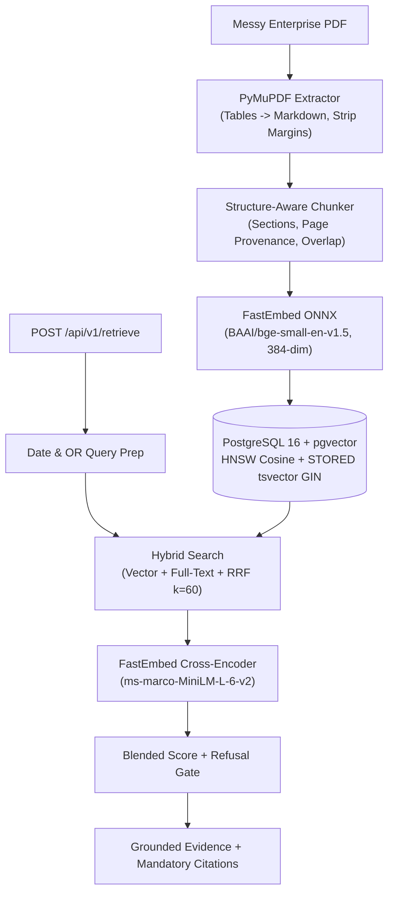

# Project 1 Architecture: Enterprise Ingestion & Retrieval Engine

## System Overview

`enterprise-rag-engine` is an independent, zero-cost, CPU-friendly document ingestion and hybrid retrieval service built for messy enterprise PDFs (regulations, policies, financial statements, technical docs).

